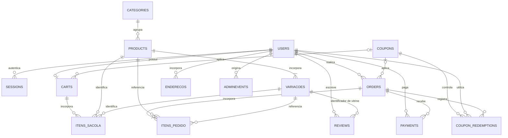

# Modelo de dados do Clube Planner no MongoDB

O modelo abaixo descreve a aplicação atual. A planilha `Dicionario_Dados_ClubePlanner_SQLite.xlsx` é uma referência relacional anterior. No MongoDB, as coleções usam `ObjectId` como identificador salvo quando indicado, e os vínculos entre documentos são mantidos pela aplicação. Valores monetários são armazenados em centavos.

## Diagrama das coleções operacionais

`VARIACOES`, `ENDERECOS`, `ITENS_SACOLA` e `ITENS_PEDIDO` são objetos embutidos. Os itens referenciam uma variação por `variantId`. `reviews.productId` é um número que corresponde a `products.variacoes[].lojaId`. O campo opcional `orders.enderecoOrigemId` identifica o endereço de origem dentro de `users.enderecos[]`, enquanto a cópia do endereço de entrega fica em `orders.enderecoEntrega`. `adminevents.entidadeId` é uma referência textual que pode apontar para entidades diferentes conforme a ação.

## Coleções para o diagrama e o dicionário

| Coleção | Campos principais | Regras relevantes |
| --- | --- | --- |
| `users` | `nome`, `email`, `cpf`, `senhaHash`, `role`, `ativo`, `emailVerificado`, `enderecos[]` | E-mail e CPF têm índices únicos parciais para contas ativas. Verificação de e-mail, troca de e-mail e recuperação de senha ficam no documento do usuário. |
| `sessions` | `userId`, `familyId`, `refreshTokenHash`, `expiresAt`, `revokedAt` | Hash do token único. Índice TTL em `expiresAt`. |
| `categories` | `nome`, `slug`, `descricao`, `ativo` | `slug` único. |
| `products` | `categoriaId`, `nome`, `slug`, `descricao`, `imagens[]`, `variacoes[]`, `ativo` | `slug` e SKU únicos. `lojaId` identifica a variação na vitrine. |
| `carts` | `userId`, `couponId`, `itens[]` | Um carrinho por usuário. Cada item guarda produto, variação e quantidade. |
| `orders` | `userId`, `status`, `pagamentoStatus`, `itens[]`, `enderecoEntrega`, `freteSnapshot`, `couponSnapshot`, `reserva`, valores e datas | O pedido guarda uma cópia dos valores, do endereço e do frete na compra. `userId + checkoutIdempotencyKey` é único para evitar pedidos duplicados. |
| `payments` | `orderId`, `userId`, `provider`, `providerPaymentId`, `status`, `capturedCentavos`, `refundSucceededCentavos` | Identificador do provedor e chave de idempotência protegidos por índices únicos compostos. O reembolso do checkout atual é registrado aqui. |
| `coupons` | `codigo`, `tipo`, `valor`, limites, vigência e contadores | `codigo` único. Tem suporte no serviço de cupons. O cupom de frete da vitrine é registrado no snapshot de frete do pedido. |
| `coupon_redemptions` | `couponId`, `userId`, `orderId`, `status`, `consumedAt`, `releasedAt` | `orderId + couponId` é único. Representa o uso de um cupom em um pedido. |
| `reviews` | `userId`, `productId` numérico, `nota`, `comentario` | Uma avaliação por usuário e item da vitrine. Nota inteira de 1 a 5. |
| `adminevents` | `actorId`, `acao`, `entidadeId`, `descricao`, `createdAt` | Histórico de eventos administrativos e do fluxo de pedidos. |
| `catalogcounters` | `_id` textual, `sequencia` | Controle da sequência usada para atribuir identificadores de vitrine. |
| `storesettings` | `_id` textual, `versao`, `nome`, `emailAtendimento`, `mensagemTopo`, `estoqueCritico` | Configurações da loja no documento `loja`. |

## Resultado da revisão

- **MongoDB local.** A consulta encontrou zero produtos sem variações ou sem categoria, zero pedidos sem usuário e zero pagamentos sem pedido. Confirmou os índices únicos de usuários ativos, produtos, pedidos e pagamentos e o TTL de sessões.
- **Atlas de produção.** A API pública respondeu com 12 itens de vitrine e 3 categorias. A conexão direta desta sessão com o Atlas expirou, então índices, referências e dados que a vitrine filtra ainda precisam ser conferidos no Data Explorer.
- **Importação de produtos.** Vale verificar se a categoria inserida por engano em `products` ainda está no Atlas. No Data Explorer, o filtro `{ "variacoes.0": { "$exists": false } }` localiza documentos sem uma primeira variação. O painel já informa quantos registros com variações inválidas foram omitidos.
- **Coleções locais legadas.** `password_reset_tokens` e `testcards` existem no MongoDB local e não têm modelo usado pelo código atual. A recuperação de senha atual usa `users.recuperacaoSenha`. Revise a origem e o uso dessas coleções antes de decidir se devem ser removidas.
- **Estrutura de reembolso fora do checkout atual.** Existe um modelo para `refunds`, mas o serviço separado `refundLedgerService.js` importa `../models/refund` e o arquivo no projeto é `refunds.js`. O checkout em uso grava o reembolso em `payments`. Corrija a importação e valide o serviço se o módulo separado for utilizado.
